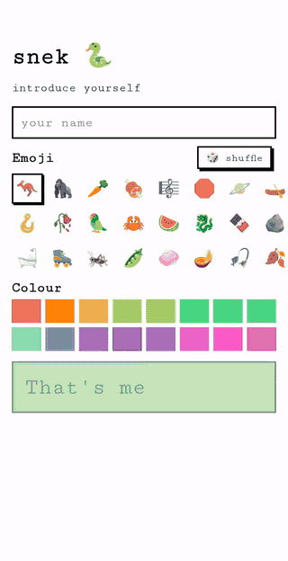

# snek

[](https://github.com/brensch/snekgame/actions/workflows/ci.yml)
[](https://github.com/brensch/snekgame/actions/workflows/ci.yml)


**Real-time multiplayer snake for phones, with a Monte Carlo tree search bot
that runs on the players' own devices.**

### ▶ Play it: [snek.brensch.com](https://snek.brensch.com)

<p align="center">
  
</p>

Start a game, send the link to your friends (or add a bot), and everyone
says they're ready. Then it's every snek for itself on a shared board: the
board ticks in real time, and whoever survives longest wins.

## Features

- **Real-time multiplayer.** Every snek moves on the same tick. Games start
  chill, normal or fast and speed up steadily as they go, reaching their
  fastest (0.2 s a tick, whatever the start) at turn 1000. Steer with the d-pad, swipes, taps on the
  board, arrow keys or WASD. Miss a tick and you keep going the way you were
  heading.
- **Battlesnake rules.** Eat to grow and refill health (you lose 1 a turn).
  Walls, bodies and bigger heads kill you; a head-on collision kills the
  shorter snek.
- **Lobbies without accounts.** Games are known by their host and shared by
  link. Pick a name, an emoji and a colour, and that's you. The home screen
  lists live games as they open, fill and start.
- **Bots that play properly.** Easy, medium and hard house bots, all the same
  search with a different thinking budget (see below). They're hard to beat.
- **A botnet of phones.** Players' devices do the bots' thinking: the server
  hands each bot's move to whichever connected phone benchmarks fastest, and
  checks every answer. The Botnet page keeps an all-time leaderboard.
- **Built for flaky phone networks.** Lock your phone mid-lobby and your seat
  and ready state wait 45 s for you. Reconnects are automatic, and a whole
  snapshot comes back on rejoin, so nothing has to be rebuilt by hand.
- **History and replays.** Every finished game is saved and can be replayed
  from the history page with a scrubber and speeds up to 32× real time.
- **One binary.** The server embeds the frontend; deploying is copying one
  file.

## Tech stack

| | |
|---|---|
| Language | Rust, end to end: one workspace, three crates |
| Frontend | [Leptos](https://leptos.dev) 0.8 (client-side rendering), compiled to WebAssembly with [trunk](https://trunkrs.dev); the board is an SVG |
| Server | [tokio](https://tokio.rs), [axum](https://github.com/tokio-rs/axum) 0.8 for HTTP, [wtransport](https://github.com/BiagioFesta/wtransport) for WebTransport |
| Wire format | [postcard](https://github.com/jamesmunns/postcard) binary frames of Rust enums shared by both ends (no JSON, no schema drift) |
| Storage | SQLite via rusqlite (bundled); each finished game is stored as one postcard blob |
| Bot | Decoupled-UCT MCTS with a time-expanded Voronoi evaluation, run in Web Workers |
| Hosting | ARM64 VM (Oracle Cloud) behind Caddy, run by systemd; cross-built with cargo-zigbuild |

### Layout

- **`shared/`** is the game: types, a deterministic rules engine, the bot and
  the wire protocol. The server runs it natively and the browser runs the
  same code as wasm.
- **`server/`** is one actor per session owning all of its state, plus the
  WebTransport endpoint, the HTTP API and SQLite history. It also serves the
  embedded frontend (brotli-compressed at startup).
- **`web/`** is the Leptos app: lobby, live game, results, history, replays
  and the botnet page, plus the Web Worker that runs bot searches.

## How it works

### Networking

All game traffic goes over **WebTransport** (HTTP/3 over QUIC, UDP 443):

- **One reliable, ordered control stream per client** carries the join,
  lobby updates, game start/end and full-state catch-ups, as length-prefixed
  postcard frames.
- **Unreliable datagrams** carry each tick's `Turn` snapshot down (sent twice,
  ~30 ms apart) and moves and pings up (repeated every 100 ms until the server
  reflects them). Every snapshot is the full state, numbered by turn, so a lost
  or late datagram never matters: the next one fixes the picture.
- QUIC has no TCP head-of-line blocking, and phones keep the connection when
  they switch between Wi-Fi and cellular.

Clients run a liveness watchdog: a connection that's been silent for 6 s, or
an attempt that hasn't connected after 4 s, is torn down and redone. Coming
back to the tab reconnects at once, and each reconnect reports how long it
took, which the server logs.

The screen only ever shows what the server last said. While a phone can't
reach the server, its page stays up but greyed out and won't take taps, so
no one acts on, or is shown, a state the other phones don't share.

### Identity and fairness

Each browser keeps a private secret that only the server sees; other players
see a hash of it. Moves are tied to the connection that sent them, never to
anything in the message, and pending moves are never broadcast. You only see
other players' moves once the turn has resolved.

### The bot

The house sneks are a port of the strongest heuristic agent from a
Battlesnake training league:

- **Decoupled UCT over joint moves.** At every node, each living snake makes
  its own UCB1 choice, so the search works out how opponents will respond
  instead of assuming it.
- **Time-expanded Voronoi evaluation.** Every head floods outward together,
  one turn per BFS layer, with body cells freeing up as tails move away. Each
  cell goes to whoever gets there first (the longer snake wins a tie), and
  that territory is weighed together with health, length, a race-to-food
  term and a trap term.
- **Guaranteed-loss pruning** drops moves that a longer head could also reach
  next turn before the search sees them.
- **The tree carries over between turns,** so each search starts thousands of
  simulations in.

Difficulty is purely the thinking budget. Searches run in a dedicated Web
Worker per bot, so the UI thread is never involved. Every answer must carry
a proof bound to the request's nonce. A bad answer earns the device a
strike, and enough strikes ban it from computing. A device that answers late
is given less time to think.

## Development

```sh
cargo test --workspace --exclude snek-web   # engine, bot and end-to-end tests over real QUIC
cd web && trunk build --release              # build the frontend into web/dist
cargo run -p snek-server                     # http on :8080, WebTransport on udp :4433
```

Open <http://localhost:8080>. With no `SNEK_CERT`/`SNEK_KEY` set, the server
makes a self-signed identity and publishes its hash at `/api/dev/wt`, and a
page on localhost connects with `serverCertificateHashes`, so local play needs
no real certificate.

| Env | Default | |
|---|---|---|
| `SNEK_PORT` | `8080` | HTTP |
| `SNEK_WT_PORT` | `4433` | WebTransport (UDP) |
| `SNEK_DB` | `snek.db` | SQLite history |
| `SNEK_CERT`, `SNEK_KEY` | self-signed | TLS identity for WebTransport |

## Deploy

```sh
make deploy     # cross-build for ARM64 in Docker, copy to the VM, restart
make setup-vm   # one-time: user, systemd unit, Caddy site, firewall
```

`make build` builds the frontend with trunk and the server as a static
`aarch64-unknown-linux-musl` binary (zig as the C cross compiler for the
bundled SQLite and ring), then exports it to `deploy/out/`.
